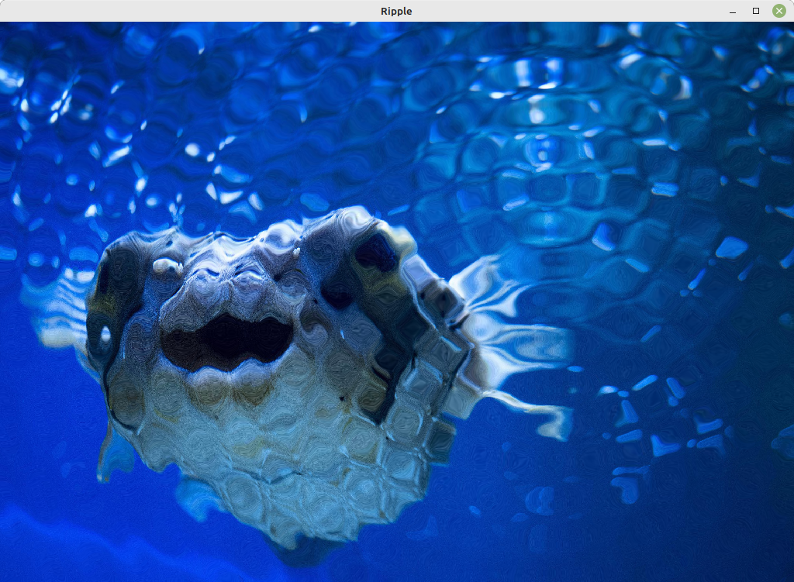
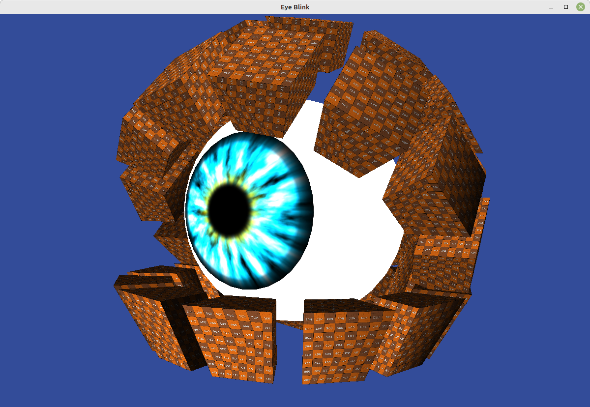

# opengl_simple_demos

Linux Mint に構築した OpenGL 開発環境が動くことを確認するためのデモ3本です。

## デモ

- 1d_dft: DFT と逆 DFT を、GPU 上で計算するサンプル  
- 2d_ripple: 波紋エフェクトの2Dサンプル   
- 3d_eye_blink: 目のまばたき動作の3Dサンプル   

## セットアップ
```bash
sudo apt update
sudo apt install -y git
sudo apt install -y build-essential
sudo apt install -y libglfw3 libglfw3-dev
sudo apt install -y libglew-dev
git clone https://github.com/marzrx/opengl_simple_demos
```

## 動かし方（ビルドと実行）

```bash
cd opengl_simple_demos/2d_ripple
make
./prog1.exe
```
## 構成

```
opengl_simple_demos/
├── 1d_dft/            デモ
├── 2d_ripple/         デモ
├── 3d_eye_blink/      デモ
├── images/            画像
└── External/
    ├── marglCommon/   共有コード
    ├── gl3w/          gl3w.c
    └── stb/           stb_image.h, stb_image_write.h
```
## 動作画面
### 2Dデモ


### 3Dデモ


## ライセンス

MIT ライセンスです。[LICENSE.txt](LICENSE.txt) を参照してください。
